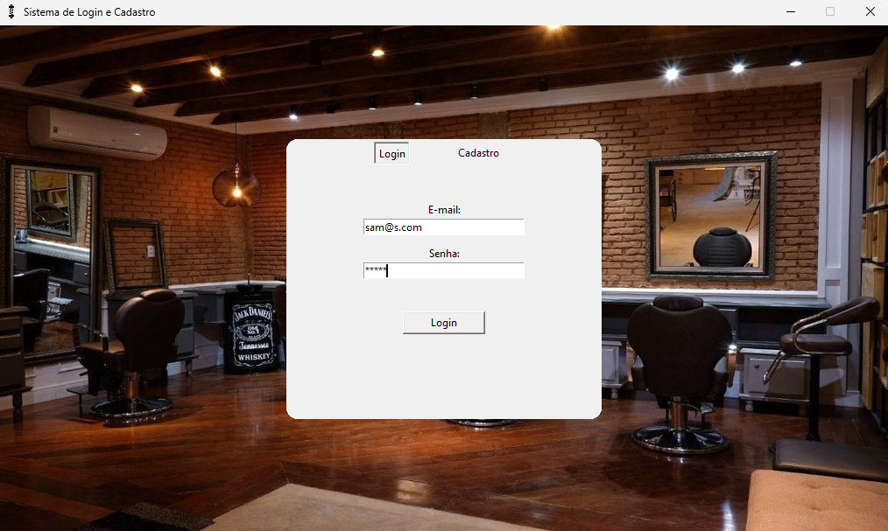
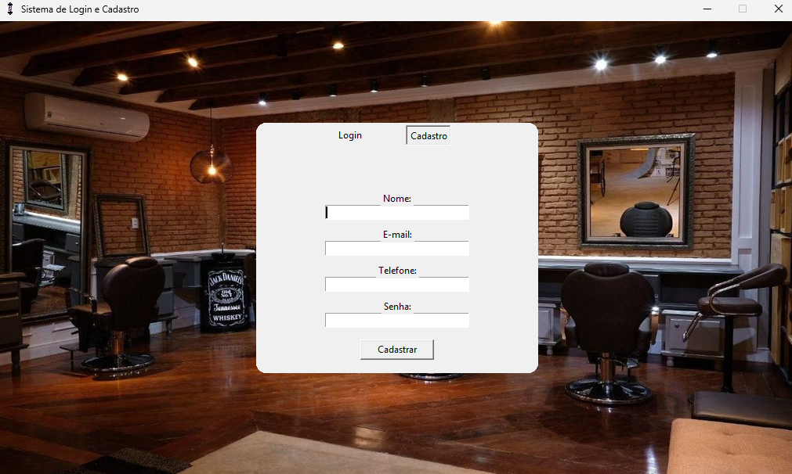
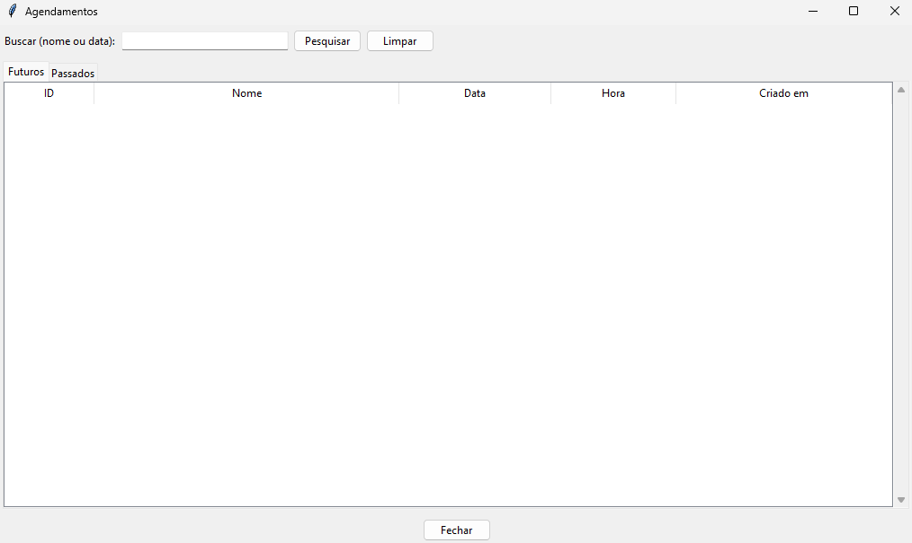
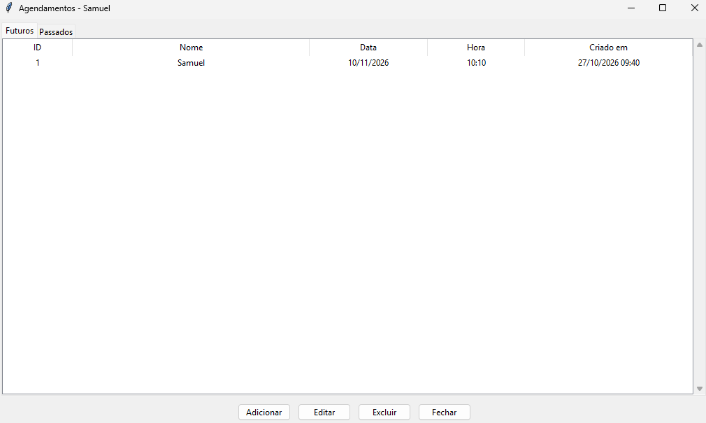

# 💈 Sistema de Login e Agendamento para Barbearia

> Sistema desktop desenvolvido em Python utilizando **Tkinter** e **SQLite**, focado no gerenciamento de usuários, autenticação segura e controle de agendamentos para barbearias ou pequenos estabelecimentos.

---

## 📸 Demonstração

   

---

## 🚀 Funcionalidades

### 👤 Para Clientes
- **Cadastro de Usuário:** Registro simplificado com validação de formato de e-mail e restrição de campos numéricos para telefone.
- **Autenticação Segura:** Senhas criptografadas com `SHA-256`.
- **Gestão de Agendamentos:** Criação, edição e exclusão de horários próprios. O sistema separa visualmente os agendamentos **Futuros** dos **Passados** em abas dedicadas.
- **Validação Inteligente:** Bloqueio automático de datas e horários retroativos.

### 🛠️ Para o Administrador (Dono)
- **Painel Administrativo Master:** Acesso com credenciais privilegiadas fixas.
- **Visão Geral Completa:** Acesso a todos os agendamentos cadastrados no sistema.
- **Busca Avançada:** Filtro por nome de cliente ou data diretamente na interface.

---

## 🛠️ Tecnologias Utilizadas

- **Linguagem:** Python 3.x
- **Interface Gráfica:** Tkinter / TTK
- **Manipulação de Imagens:** Pillow (PIL) para efeitos visuais, redimensionamento e painéis semi-transparentes em formato arredondado.
- **Banco de Dados:** SQLite3 (gerenciamento local integrado via `app.db`).
- **Segurança:** Módulo `hashlib` para hash de senhas.

---

## 🔑 Credenciais do Administrador
Para acessar o painel do administrador (dono) do sistema:

- **E-mail:** sam@s.com
- **Senha:** 12345
